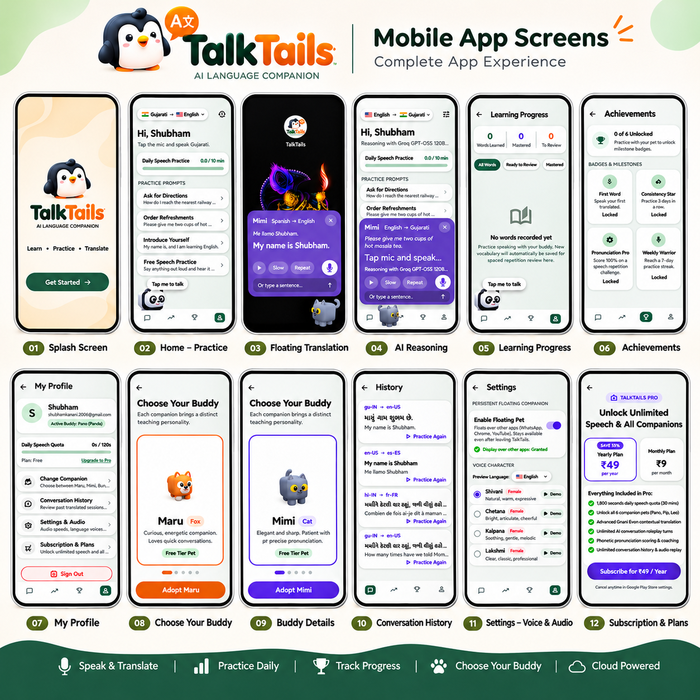
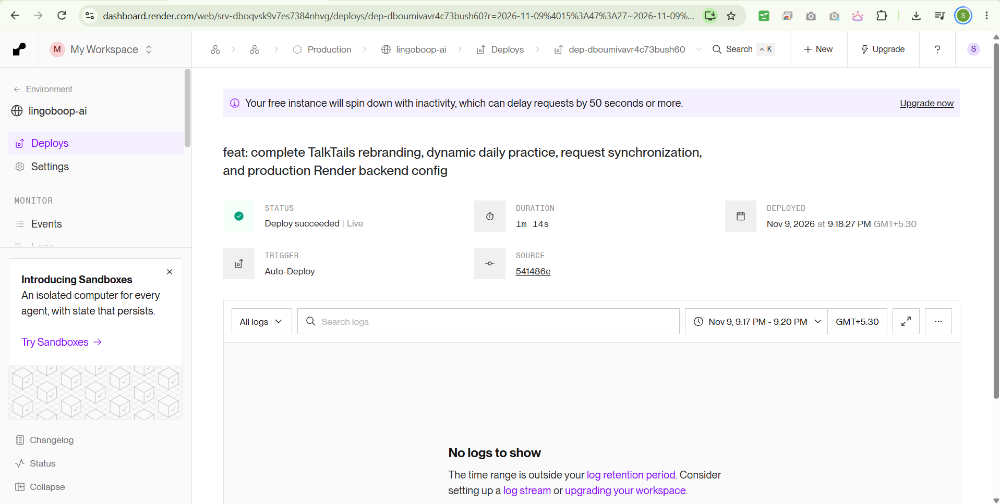
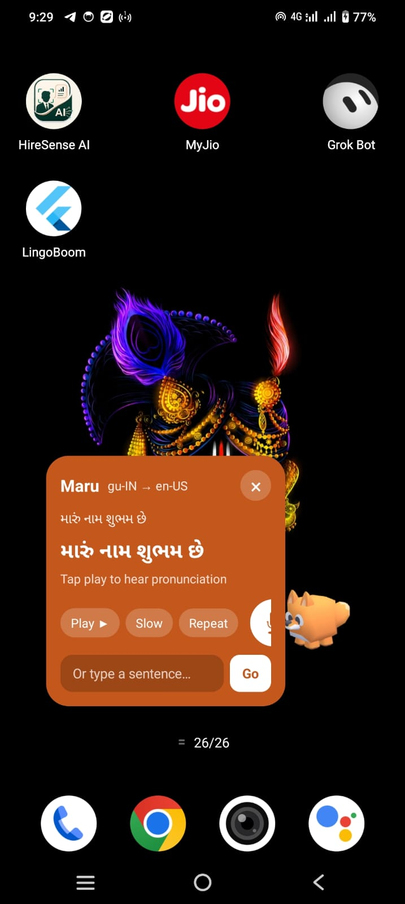
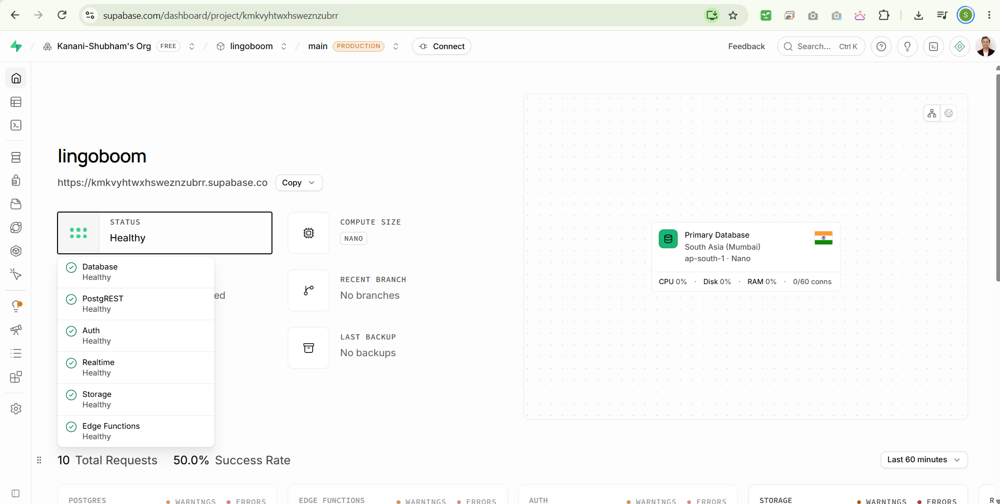
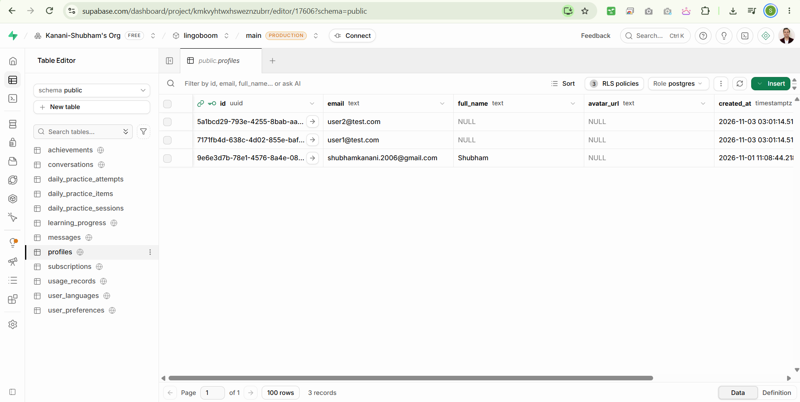
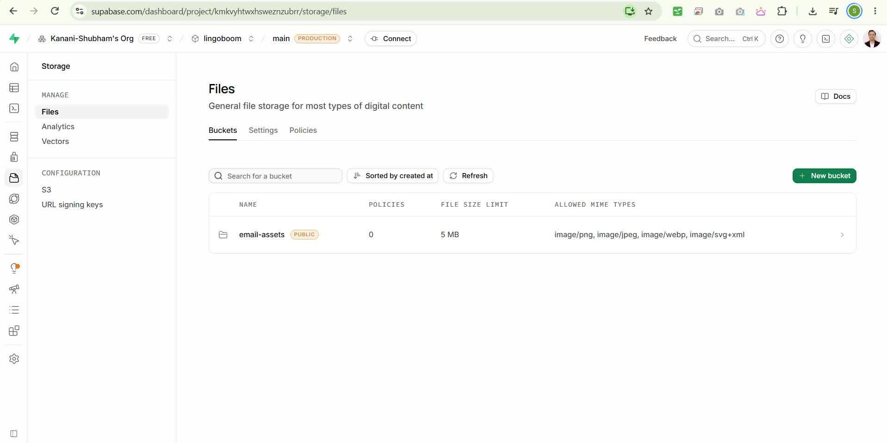
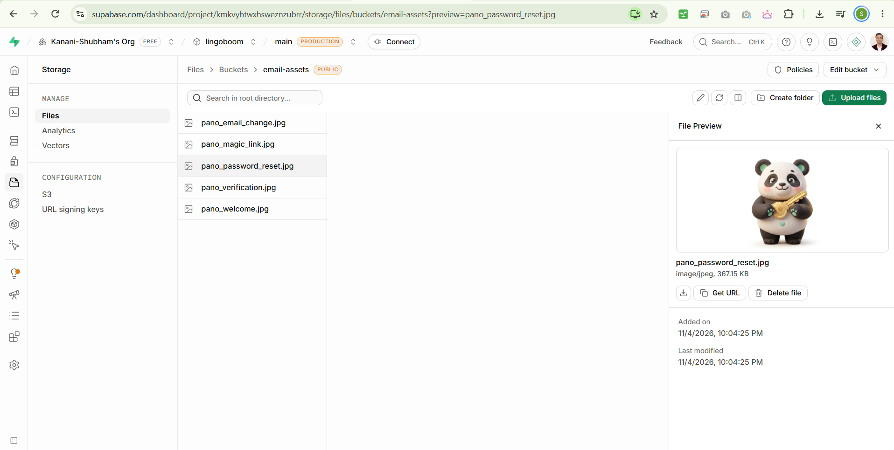
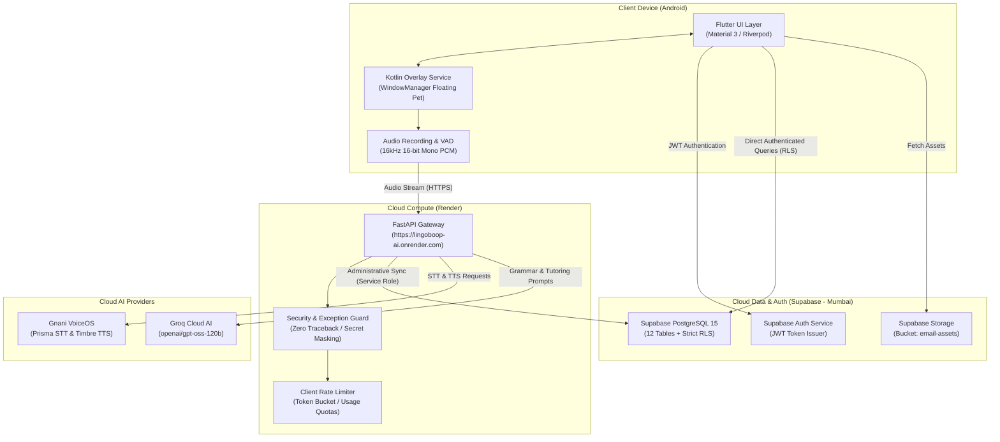

```text
  _______      _ _   _______    _ _         _____ _                 _ 
 |__   __|    | | | |__   __|  (_) |       / ____| |               | |
    | | __ _  | | | __ | | __ _ _| |___   | |    | | ___  _   _  __| |
    | |/ _` | | | |/ / | |/ _` | | / __|  | |    | |/ _ \| | | |/ _` |
    | | (_| | | |   <  | | (_| | | \__ \  | |____| | (_) | |_| | (_| |
    |_|\__,_| |_|_|\_\ |_|\__,_|_|_|___/   \_____|_|\___/ \__,_|\__,_|
```

# TalkTails — AI-Powered Language Learning Companion

> **A cloud-connected mobile application combining speech recognition, AI-powered translation, and natural pronunciation practice.**

---

## 1. Project Introduction

**TalkTails** (formerly LingoBoom) is an intelligent, interactive language-learning companion designed to bridge conversational barriers in real time. Deployed across cloud infrastructure, TalkTails brings together on-device floating companion mechanics, cloud-native speech recognition for Indic languages, large language model intelligence, and managed cloud databases.

Engineered as part of the **GMIU Cloud Computing — ALA-1: Cloud Service Deployment** curriculum at Gyan Manjari Innovative University, TalkTails demonstrates the end-to-end integration of modern cloud compute, managed PostgreSQL databases, cloud object storage, and serverless AI APIs into a responsive mobile user experience.

---

## 2. GitHub Badges

[](https://github.com/Kanani-Shubham/TalkTails-Cloud)
[](https://flutter.dev)
[](https://dart.dev)
[](https://www.python.org)
[](https://fastapi.tiangolo.com)
[](https://render.com)
[](https://supabase.com)
[](https://supabase.com)
[](https://gnani.ai)
[](https://groq.com)
[](LICENSE)

---

## 3. Project Overview

TalkTails transforms language learning from static memorization into dynamic, real-time contextual conversation. The application lives directly on the user's mobile screen as an animated 3D companion pet that stays accessible across any application via Android's native window overlay system.

### Core Capabilities:
- **Spoken Language Translation:** Converts spoken speech in regional Indian languages (e.g., Gujarati `gu-IN`, Hindi `hi-IN`) directly into target languages like English (`en-US`).
- **Interactive Audio Pronunciation:** Synthesizes natural speech for translated text with pitch, tone, and pacing suitable for learners.
- **Adjustable Playback Speed:** Allows learners to toggle between normal speed and slow pronunciation playback (0.75x) to catch subtle phonemes.
- **Repeat & Pronunciation Evaluation:** Prompts learners to repeat phrases into the microphone, evaluating accuracy and fluency in real time.
- **Bilingual Dialogue & Input:** Supports both voice recognition and direct keyboard input for rapid translation queries.
- **3D Animated Companion Roster:** Features 6 customizable low-poly characters (Maru the Fox, Mimi the Cat, Pano the Panda, Bun the Bunny, Pip the Penguin, and Leo the Lion) with expressive skeletal animations and physics-based interactions.

---

## 4. Key Features

| Feature | Technical Implementation | Practical Benefit |
|---|---|---|
| **Floating Screen Companion** | Android Kotlin `WindowManager` (`TYPE_APPLICATION_OVERLAY`) | Always accessible across other apps without switching contexts |
| **Native Voice Activity Detection** | Client-side energy/silence thresholding | Eliminates clipped sentence endings and trailing word loss |
| **Indic Speech-to-Text (STT)** | Gnani Prisma v3.0 REST & WebSocket gateway | High-accuracy transcription for Indic dialects |
| **Neural Text-to-Speech (TTS)** | Gnani Timbre v3.0 neural voice models | Natural accents (Shivani, Chetana, Lakshmi, etc.) |
| **Contextual AI Tutoring** | Groq Cloud LPU (`openai/gpt-oss-120b`) | Real-time grammar explanations and contextual feedback |
| **Cloud State Synchronization** | Supabase PostgreSQL 15 with Row Level Security | Persists profiles, preferences, and daily progress securely |
| **Spaced Repetition Practice** | Supabase practice sessions & streak algorithms | Daily tailored practice sentences with attempt histories |
| **Cloud Asset Distribution** | Supabase Storage CDN buckets | Fast, low-latency delivery of avatar assets and templates |

---

## 5. Application Screenshots

### 5.1 Complete Mobile App Experience (12 Screens)


*Figure 1: Complete TalkTails mobile application workflow featuring 12 primary application modules across navigation, AI assistance, 3D companion customization, and cloud synchronization.*

| Screen # | Module Name | Key Functionality |
|:---:|---|---|
| **01** | **Splash Screen** | Animated mascot welcome, brand introduction (*Learn • Practice • Translate*), and initial authentication entry. |
| **02** | **Home — Practice** | Daily speech practice goals (e.g., 0.0/10 min), quick practice prompts (*Directions*, *Refreshments*, *Introductions*), and microphone trigger. |
| **03** | **Floating Translation** | Native Android floating overlay (`WindowManager`) presenting real-time translation with pronunciation audio and replay controls. |
| **04** | **AI Reasoning** | Multi-lingual reasoning view driven by Groq Cloud (`openai/gpt-oss-120b`) explaining syntax rules and linguistic nuances. |
| **05** | **Learning Progress** | Spaced repetition vocabulary dashboard tracking *Words Learned*, *Mastered*, and *To Review*. |
| **06** | **Achievements** | Gamified milestone badges (*First Word*, *Consistency Star*, *Pronunciation Pro*, *Weekly Warrior*) synchronized with cloud state. |
| **07** | **My Profile** | Account overview, active companion display, daily speech quota consumption tracker, and tier status. |
| **08** | **Choose Your Buddy** | 3D pet companion selection carousel showcasing personality descriptions and animation models (e.g. *Maru the Fox*). |
| **09** | **Buddy Details** | Detailed companion preview with character-specific traits, accent styles, and one-tap adoption. |
| **10** | **Conversation History** | Historical bilingual transcripts (`gu-IN` ↔ `en-US`, `hi-IN` ↔ `fr-FR`) with one-tap *Practice Again* audio replay. |
| **11** | **Settings — Voice & Audio** | Floating companion permissions toggle, preview language selector, and neural voice picker (*Shivani*, *Chetana*, *Kalpana*, *Lakshmi*). |
| **12** | **Subscription & Plans** | Entitlements and tier upgrade options (*Free*, *Monthly ₹9*, *Yearly ₹49*) for expanded speech quotas and advanced AI models. |

---

### 5.2 Cloud Platform & Application Gallery (2×2 Box Grid)

| 🚀 Cloud Compute (Render) | 📱 Live Android Companion |
|:---:|:---:|
| [](screenshots/01-render-deployment.png)<br><sub>**Figure 2:** Render Web Service continuous deployment dashboard (`lingoboop-ai`) from commit `541486e`</sub> | [](screenshots/02-talktails-android-app.png)<br><sub>**Figure 3:** Live Android floating companion (*Maru*) with real-time speech translation ("મારું નામ શુભમ છે")</sub> |
| **🏥 Supabase Project Health** | **🗄️ Supabase Relational Database** |
| [](screenshots/03-supabase-project-health.png)<br><sub>**Figure 4:** 100% operational health across Database, PostgREST API, Auth, Realtime, and Storage</sub> | [](screenshots/04-supabase-database.png)<br><sub>**Figure 5:** PostgreSQL database schema displaying `profiles` with active Row Level Security (RLS)</sub> |
| **📦 Cloud Storage Buckets** | **🔍 Stored File Preview Inspector** |
| [](screenshots/05-supabase-storage-buckets.png)<br><sub>**Figure 6:** Supabase public CDN bucket (`email-assets`) configured with 5 MB file size constraints</sub> | [](screenshots/06-supabase-storage-file-preview.png)<br><sub>**Figure 7:** Supabase Storage file preview inspector serving cloud-hosted asset (`pano_password_reset.jpg`)</sub> |

---

## 6. Technology Stack

```
TalkTails Solution Architecture
├── Client Tier (Mobile Application)
│   ├── Flutter 3.47.7 & Dart 3.13.5 (Cross-Platform Framework)
│   ├── Flutter Riverpod 2.5 (Reactive State Management)
│   ├── Kotlin 2.4 & Android Jetpack (Foreground Service & WindowManager)
│   └── ThreeJS / WebGL / Kenney Low-Poly GLB (3D Character Roster)
│
├── Cloud Compute Tier (Backend Gateway)
│   ├── Python 3.12 (Asynchronous Runtime)
│   ├── FastAPI 0.115 (High-Performance REST Framework)
│   ├── Uvicorn (ASGI Production Server)
│   ├── Pydantic v2 (Strict Schema Validation & Secret Masking)
│   └── Render Cloud Web Services (Containerized Cloud Hosting)
│
├── Cloud Database & Storage Tier (Supabase)
│   ├── Supabase PostgreSQL 15 (Managed Relational Database)
│   ├── Supabase Auth (JWT Bearer Token Authentication)
│   ├── Row Level Security - RLS (Granular Multi-Tenant Access Control)
│   └── Supabase Storage S3-Compatible Buckets (Static Asset CDN)
│
└── External Cloud AI & Speech Providers
    ├── Gnani.ai VoiceOS (Prisma v3.0 STT & Timbre v3.0 TTS)
    └── Groq Cloud (Ultra-Fast LLM Inference on openai/gpt-oss-120b)
```

---

## 7. System Architecture

The following diagram illustrates how the Flutter client interacts securely with the Render compute backend, the Supabase data tier, and upstream AI speech providers:



---

## 8. Cloud Infrastructure

TalkTails utilizes a multi-cloud design to achieve high availability, low latency, and zero operational server management:

1. **Render (Cloud Application Compute):**
   - Automatically synchronizes with the `main` branch of this GitHub repository.
   - Deploys the Python FastAPI backend inside an isolated container with HTTPS termination.
   - Executes non-blocking asynchronous event loops to coordinate speech-to-text, LLM completions, and speech synthesis without I/O blocking.

2. **Supabase (Cloud PostgreSQL & Storage):**
   - Hosted in the **South Asia (Mumbai) `ap-south-1`** region to minimize round-trip network latency for Indian regional language learners.
   - Managed PostgreSQL 15 cluster providing relational integrity, ACID transactions, and automated health checks.
   - Built-in S3-compatible cloud storage buckets for distributing media assets.

3. **External AI Inference:**
   - **Gnani.ai:** Enterprise Indian speech platform specializing in acoustic and linguistic models for 12+ Indic languages.
   - **Groq Cloud:** Low-latency Language Processing Units (LPUs) generating instant grammar explanations and conversational feedback.

---

## 9. Cloud Deployment Details

- **Backend Production URL:** `https://lingoboop-ai.onrender.com`
- **Health Check Endpoint:** `https://lingoboop-ai.onrender.com/health`
- **Supabase Cloud URL:** `https://kmkvyhtwxhsweznzubrr.supabase.co`
- **Hosting Region:** Mumbai, India (`ap-south-1` for database) & Oregon/Frankfurt (Render compute)

> [!NOTE]
> **Free Instance Cold-Start Note:**  
> The backend runs on a Render Free Web Service instance. In accordance with Render's infrastructure policies, free tier instances spin down after 15 minutes of inactivity. The first request after a period of dormancy will take approximately **50 seconds** to initialize the container. Subsequent requests execute with sub-second response times.

---

## 10. Database & Storage

The database layer runs on managed PostgreSQL 15 on Supabase and consists of 12 normalized relational tables protected by **Row Level Security (RLS)**:

```
Database Schema Overview
├── profiles                      # User accounts, display names, timestamps
├── user_preferences              # Active pet, sound speed, overlay settings
├── user_languages                # Native language, target language, proficiency
├── conversations                 # Conversation sessions with companion
├── messages                      # Individual chat turns, translations, scores
├── learning_progress             # Spaced repetition intervals and mastery metrics
├── achievements                  # Gamification unlocks and badges
├── subscriptions                 # User tier (Free, Monthly, Yearly)
├── usage_records                 # Audio seconds consumed vs. daily quota
├── daily_practice_sessions       # Daily dated learning sessions
├── daily_practice_items          # Practice phrases and target phonetic texts
└── daily_practice_attempts       # User recordings, pronunciation scores, status
```

### Storage Buckets:
- **`email-assets` (Public):** Serves brand assets, character avatars (`pano_welcome.jpg`, `pano_password_reset.jpg`), and email notification templates.

---

## 11. API Documentation

### 11.1 System Health
```http
GET /health
```
**Response (200 OK):**
```json
{
  "success": true,
  "data": {
    "status": "healthy",
    "app_name": "LingoBoom-Backend",
    "environment": "production",
    "gnani_provider": {
      "configured": true,
      "base_url": "https://api.vachana.ai",
      "stt_model": "prisma-v3.0",
      "tts_model": "timbre-v3.0",
      "api_key_status": "present"
    },
    "supabase": {
      "configured": true,
      "service_role_configured": true
    }
  }
}
```

### 11.2 AI Tutor & Translation
```http
POST /api/v1/ai/tutor
Content-Type: application/json

{
  "message": "મારું નામ શુભમ છે",
  "source_language": "gu-IN",
  "target_language": "en-US",
  "character_id": "maru",
  "mode": "translate"
}
```
**Response (200 OK):**
```json
{
  "success": true,
  "data": {
    "translated_text": "My name is Shubham.",
    "pronunciation_guide": "My name is Shubham",
    "grammar_notes": "'મારું' translates to 'My', 'નામ' translates to 'name', and 'છે' is the verb 'is'.",
    "companion_reply": "Great sentence! Here is how you say it in English."
  }
}
```

### 11.3 Speech-to-Text Transcription
```http
POST /api/v1/stt/transcribe
Content-Type: multipart/form-data

audio_file: [binary .wav]
language_code: "gu-IN"
model: "prisma-v3.0"
```
**Response (200 OK):**
```json
{
  "success": true,
  "data": {
    "transcript": "મારું નામ શુભમ છે",
    "confidence": 0.98,
    "language_code": "gu-IN"
  }
}
```

### 11.4 Text-to-Speech Synthesis
```http
POST /api/v1/tts/synthesize
Content-Type: application/json

{
  "text": "My name is Shubham.",
  "language_code": "en-US",
  "voice_id": "Shivani",
  "speed": 1.0
}
```

---

## 12. Installation & Setup

### Prerequisites
- **Flutter SDK:** 3.47.x or higher ([Install Flutter](https://docs.flutter.dev/get-started/install))
- **Dart SDK:** 3.13.x or higher (Bundled with Flutter)
- **Python:** 3.12 or higher ([Install Python](https://www.python.org/downloads/))
- **Android Studio / SDK:** Android SDK 34, Java 17, and an Android device or emulator running Android 8.0+ (API 26+)

### Clone the Repository
```bash
git clone https://github.com/Kanani-Shubham/TalkTails-Cloud.git
cd TalkTails-Cloud
```

---

## 13. Environment Variables

Create environment configuration files using the provided templates. **Never commit real `.env` files to git.**

### Backend (`backend/.env`)
```bash
cp backend/.env.example backend/.env
```

| Variable | Description | Required | Source |
|---|---|---|---|
| `APP_ENV` | Application environment (`development` / `production`) | Yes | Internal |
| `DEBUG` | Enable Swagger `/docs` and debug logs | Optional | Default `false` |
| `GROQ_API_KEY` | Groq Cloud API authorization token | Yes | [console.groq.com](https://console.groq.com) |
| `GROQ_MODEL` | LLM model (`openai/gpt-oss-120b`) | Yes | Internal |
| `GNANI_BASE_URL` | Gnani API endpoint (`https://api.vachana.ai`) | Yes | [vachana.ai](https://api.vachana.ai) |
| `GNANI_API_KEY_ID` | Gnani Speech Dashboard API key | Yes | [gnani.ai](https://gnani.ai) |
| `SUPABASE_URL` | Supabase project URL | Yes | [supabase.com](https://supabase.com) |
| `SUPABASE_ANON_KEY` | Client-safe anonymous key | Yes | Supabase API Settings |
| `SUPABASE_SERVICE_ROLE_KEY` | Administrative backend-only key | Yes | Supabase API Settings |
| `DATABASE_URL` | Direct PostgreSQL connection string | Yes | Supabase Database Settings |

### Flutter Client (`.env` or `--dart-define`)
```bash
cp .env.example .env
```

| Variable | Description | Scope |
|---|---|---|
| `BACKEND_URL` | Target FastAPI backend base URL | Client Build |
| `SUPABASE_URL` | Supabase project URL | Client Build |
| `SUPABASE_ANON_KEY` | Public Supabase anon key (RLS-protected) | Client Build |

---

## 14. Running Locally

### 14.1 Launch Backend Service
```bash
# Navigate to backend directory
cd backend

# Create and activate Python virtual environment
python -m venv .venv
# Windows:
.\.venv\Scripts\activate
# Linux/macOS:
source .venv/bin/activate

# Install dependencies
pip install -r requirements.txt

# Start FastAPI development server
uvicorn app.main:app --host 127.0.0.1 --port 8000 --reload
```
Access local API documentation at `http://127.0.0.1:8000/docs` (when `DEBUG=true`).

### 14.2 Run Unit Tests
```bash
# Execute backend test suite
python -m pytest backend/tests --ignore=backend/tests/test_supabase_rls_isolation.py

# Execute Flutter test suite
flutter test
```

### 14.3 Launch Android Mobile App
```bash
# Fetch Flutter packages
flutter pub get

# Verify environment cleanliness
flutter analyze

# Launch on connected Android device or emulator
flutter run --dart-define=BACKEND_URL=http://10.0.2.2:8000
```
*(Note: Use `10.0.2.2` to access host `localhost` from standard Android emulators).*

---

## 15. Deployment Guide

Refer to the complete step-by-step deployment document:  
📄 **[Detailed Cloud Deployment Guide](docs/DEPLOYMENT.md)**

Quick deployment summary:
1. Connect your repository to **Render**.
2. Select root directory `backend`, build command `pip install -r requirements.txt`, and start command `uvicorn app.main:app --host 0.0.0.0 --port $PORT`.
3. Add backend environment variables on Render.
4. Execute SQL migrations in **Supabase** SQL editor.
5. Create the `email-assets` public storage bucket on Supabase.
6. Compile the release APK with production `--dart-define` keys.

---

## 16. Security

TalkTails adheres to defense-in-depth principles:
- **Zero Secrets in Version Control:** All `.env` and credential files are strictly ignored by Git. Automated scans verify that no private keys exist in tracked files or commit logs.
- **Client Privilege Isolation:** The Flutter application only contains public endpoints and the Supabase anonymous key (`role: anon`). All sensitive operations (Gnani AI tokens, Groq API keys, and Supabase Service Role keys) run exclusively on the backend.
- **Row Level Security (RLS):** All database operations originating from clients are verified by PostgreSQL RLS policies against `auth.uid() = user_id`.
- **Runtime Secret Masking:** The backend settings layer automatically masks keys in logs and `repr()` representations (e.g. `gn_l...8899`), preventing credential leakage in stdout or APM traces.

Read the comprehensive security evaluation:  
🔒 **[Security Audit Report](docs/SECURITY_AUDIT.md)**

---

## 17. ALA-1: Cloud Service Deployment

This project satisfies the practical requirements of **GMIU Cloud Computing — ALA-1: Cloud Service Deployment**:

| Academic Requirement | Cloud Technology Employed | Verified Implementation in Repository | Screenshot Reference |
|---|---|---|---|
| **1. Cloud Compute** | Render Cloud Web Services | Containerized Python FastAPI backend with zero-downtime automated deployment from GitHub `main`. | `screenshots/01-render-deployment.png` |
| **2. Cloud Database** | Supabase Managed PostgreSQL 15 | Relational database in South Asia Mumbai (`ap-south-1`) with 12 structured tables and active RLS policies. | `screenshots/03-supabase-project-health.png`, `screenshots/04-supabase-database.png` |
| **3. Cloud Storage** | Supabase Storage (S3 API) | Public cloud storage bucket (`email-assets`) serving images, character previews, and notification templates. | `screenshots/05-supabase-storage-buckets.png`, `screenshots/06-supabase-storage-file-preview.png` |
| **4. Internet Accessibility** | Global HTTPS Endpoints | Publicly reachable REST API on `https://lingoboop-ai.onrender.com` accessible from mobile networks worldwide. | `screenshots/01-render-deployment.png`, `screenshots/02-talktails-android-app.png` |
| **5. Resource Management** | Render & Supabase Free Tiers | Cost-effective resource sizing: Nano PostgreSQL compute, free web service with automated sleep/wake lifecycle. | `screenshots/01-render-deployment.png`, `screenshots/03-supabase-project-health.png` |

---

## 18. Project Folder Structure

```
TalkTails-Cloud/
│
├── README.md                              # Master project documentation
├── .gitignore                             # Git ignore rules for Flutter & Python
├── .env.example                           # Root environment variable template
├── pubspec.yaml                           # Flutter dependencies & asset manifest
├── analysis_options.yaml                  # Dart analyzer & linter rules
│
├── screenshots/                           # Standardized project verification screenshots
│   ├── 00-talktails-app-screens-infographic.png # Complete 12-screen mobile app infographic
│   ├── 01-render-deployment.png           # Render Web Service dashboard
│   ├── 02-talktails-android-app.png       # Live Android floating companion
│   ├── 03-supabase-project-health.png     # Supabase health & infrastructure status
│   ├── 04-supabase-database.png           # Supabase PostgreSQL relational schema
│   ├── 05-supabase-storage-buckets.png    # Supabase Cloud Storage bucket list
│   └── 06-supabase-storage-file-preview.png # Supabase stored file preview inspector
│
├── docs/                                  # Technical engineering documentation
│   ├── ARCHITECTURE.md                    # Detailed multi-tier architecture & data flows
│   ├── DEPLOYMENT.md                      # Complete cloud deployment guide
│   ├── SECURITY_AUDIT.md                  # Comprehensive security & threat assessment
│   └── Database.md                        # Complete database schema reference
│
├── backend/                               # Python FastAPI backend service
│   ├── app/
│   │   ├── main.py                        # FastAPI application initialization & CORS
│   │   ├── core/                          # Settings, security, and rate limiting
│   │   ├── routers/                       # API endpoints (health, AI, STT, TTS)
│   │   ├── providers/                     # Gnani STT/TTS & Groq LLM service integrations
│   │   └── schemas/                       # Pydantic request & response models
│   ├── tests/                             # Pytest automated test suite (37 passing tests)
│   ├── requirements.txt                   # Production Python dependencies
│   └── .env.example                       # Backend environment template
│
├── lib/                                   # Flutter client application
│   ├── core/                              # App configuration, themes, constants
│   ├── features/                          # Companion, speech, daily practice, auth
│   └── main.dart                          # Flutter application entry point
│
├── android/                               # Android native platform project (Kotlin)
├── assets/                                # 3D GLB models, animations, and graphics
└── test/                                  # Flutter test suite (39 passing tests)
```

---

## 19. Future Improvements

- [ ] **Multi-turn Contextual Conversation:** Maintain localized conversation threads in the floating companion mode.
- [ ] **Offline Translation Fallback:** Package lightweight on-device models for emergency offline phrase translations.
- [ ] **Interactive Pronunciation Heatmap:** Provide word-by-word syllable stress visualization on the mobile screen.
- [ ] **iOS Window Pip Extension:** Explore Picture-in-Picture (PiP) APIs for companion rendering on iOS devices.
- [ ] **Automated CI/CD Test Pipeline:** Add GitHub Actions workflows running `flutter test` and `pytest` on every pull request.

---

## 20. Author

**Shubham Kanani**  
B.Tech Information Technology Student  
**Gyan Manjari Innovative University (GMIU)**  
Bhavnagar, Gujarat, India  

*Passionate about engineering AI-powered user experiences, cloud-connected mobile applications, and resilient distributed architectures.*

---

## 21. Connect With Me

- **Portfolio:** [https://shubhamkanani.netlify.app/](https://shubhamkanani.netlify.app/)
- **GitHub:** [@Kanani-Shubham](https://github.com/Kanani-Shubham)
- **LinkedIn:** [Shubham Kanani](https://www.linkedin.com/in/shubham-kanani-5694802b3/)
- **Email:** `shubhamkanani.2006@gmail.com`

---

## 22. License

This project was developed for academic, educational, and open-source demonstration purposes under the **MIT License**.  
All 3D character assets are adapted from the CC0 Public Domain Kenney Cube Pets collection. Refer to `product_context/licenses/ASSET_LICENSES.md` for specific third-party asset licenses.
