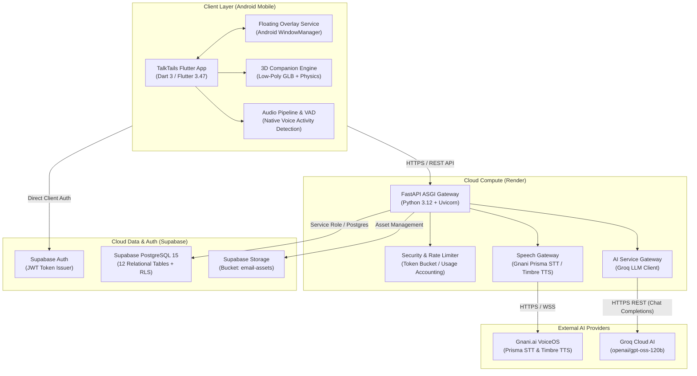
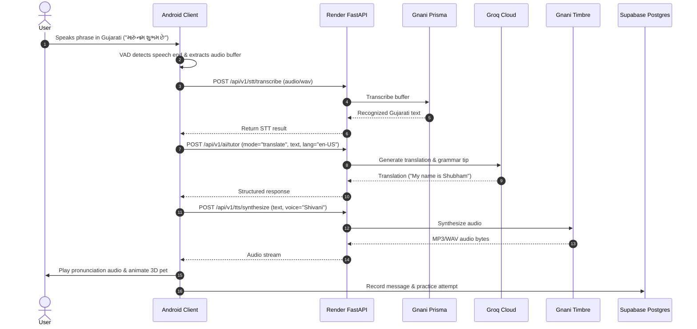

# TalkTails Cloud — System Architecture Documentation

**Project:** TalkTails (TalkTails-Cloud)  
**System Category:** Distributed AI-Powered Language Learning & Cloud Deployment  
**Repository:** [https://github.com/Kanani-Shubham/TalkTails-Cloud](https://github.com/Kanani-Shubham/TalkTails-Cloud)

---

## 1. High-Level Architecture Overview

TalkTails is architected as an end-to-end distributed cloud system comprising a cross-platform client with an Android floating companion, a stateless high-concurrency Python backend running on Render, an enterprise-grade cloud database and storage engine on Supabase, and real-time AI/speech pipelines powered by Gnani VoiceOS and Groq Cloud.

---

## 2. Component Specifications

### 2.1 Mobile Application (`mobile/` & `lib/`)
- **Framework:** Flutter 3.47+ (Dart 3.13+)
- **State Management:** Riverpod 2.x with auto-disposing providers and stream listeners.
- **Floating Overlay Integration:**
  - Implemented via an Android Foreground Service using Kotlin `WindowManager` (`TYPE_APPLICATION_OVERLAY`).
  - Supports dragging across screen boundaries with natural gravity snap physics.
  - Floating card (PolyCard) expands on single-tap to present real-time translation, pronunciation feedback, and audio playback controls.
- **3D Character Rendering:**
  - Production-ready low-poly binary GLB models (under 175 KB each).
  - 6 distinct character avatars: Maru (Fox), Mimi (Cat), Pano (Panda), Bun (Bunny), Pip (Penguin), and Leo (Lion).
  - Baked skeletal animations: `idle`, `walk`, `run`, `eat`/think, `dance`/cheer, `gesture-positive`/talk, `gesture-negative`/oops, and `static`.
- **Speech Capture & VAD:**
  - Native Voice Activity Detection (VAD) with silence thresholding to prevent trailing word loss in regional languages (e.g., Gujarati sentence markers).

### 2.2 Cloud Backend Service (`backend/`)
- **Framework:** Python 3.12+ with FastAPI and Pydantic v2 validation.
- **ASGI Server:** Uvicorn with asynchronous worker loop.
- **Hosting Platform:** Render Web Services (Free Tier, Linux Container, Region: Oregon / Frankfurt / Singapore depending on cluster routing).
- **Security Middleware:**
  - Safe exception interceptors preventing stack trace or secret disclosure.
  - Pydantic Settings with automatic credential masking in `__repr__`.
  - Rate limiting with token bucket per client IP/ID.
- **Core API Endpoints:**
  - `GET /health`, `GET /api/v1/health`: System status and upstream provider connectivity check.
  - `POST /api/v1/ai/tutor`: Conversational tutoring, contextual grammar explanations, and pet responses.
  - `POST /api/v1/ai/translate`: AI-assisted phrase translation with colloquial nuances.
  - `POST /api/v1/stt/transcribe`: Audio buffer speech-to-text conversion via Gnani Prisma.
  - `POST /api/v1/tts/synthesize`: Text-to-speech audio synthesis via Gnani Timbre.
  - `GET /api/v1/tts/voices`: Registry of verified voices (e.g., Shivani, Chetana, Lakshmi).

### 2.3 Cloud Database & Storage (Supabase)
- **Database Engine:** Managed PostgreSQL 15 on Supabase (Region: South Asia Mumbai `ap-south-1`).
- **Security & Authorization:**
  - Row Level Security (RLS) enabled across tables.
  - Public anonymous key used for authorized client queries constrained by `auth.uid() = user_id`.
  - Service-role key utilized strictly by the backend for privileged telemetry and sync jobs.
- **Data Model:**
  - `profiles`: User account details, display names, and avatars.
  - `user_preferences`: Active character, audio speed, overlay toggles, and voice settings.
  - `user_languages`: Native language, target language, and proficiency level.
  - `conversations` & `messages`: Chat logs, transcripts, audio storage paths, and pronunciation scores.
  - `learning_progress`: Spaced repetition tracking, mastery scores, and review intervals.
  - `daily_practice_sessions`, `daily_practice_items`, `daily_practice_attempts`: Synchronized daily exercises and performance history.
  - `achievements`, `subscriptions`, `usage_records`: Gamification and quota enforcement.
- **Cloud Storage:**
  - Bucket: `email-assets` (Public CDN for email templates, character badge previews, and avatar art).

### 2.4 External AI & Speech Services
- **Gnani.ai VoiceOS (`api.vachana.ai`):**
  - **Prisma v3.0 STT:** High-accuracy acoustic model specialized in Indic languages (Gujarati `gu-IN`, Hindi `hi-IN`, Indian English `en-IN`).
  - **Timbre v3.0 TTS:** High-fidelity neural voice synthesis with adjustable playback rates and custom voice personas.
- **Groq Cloud AI (`api.groq.com`):**
  - Model: `openai/gpt-oss-120b` (LPU ultra-low latency inference).
  - Delivers real-time grammar feedback, language translation, and interactive responses.

---

## 3. Data Flow Sequences

### 3.1 Speech-to-Translation Flow

---

## 4. Scalability & Resilience Design

1. **Stateless Backend Nodes:**
   - The FastAPI backend maintains no in-memory session state; horizontal scaling on Render or Kubernetes requires zero session synchronization.
2. **Cold-Start Handling:**
   - Because Render free instances spin down after 15 minutes of inactivity, the client implements timeout tolerance and fallback offline translation buffers for critical UI states.
3. **Graceful Upstream Degradation:**
   - If Groq or Gnani experiences elevated latency, the backend returns explicit error codes and the client surfaces informative companion tooltips rather than freezing the interface.
